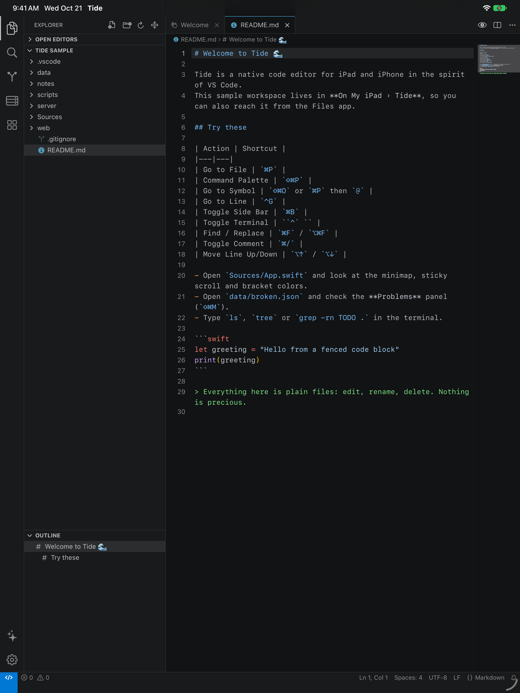

# Tide

**A native code editor for iPad and iPhone, in the spirit of VS Code.**

Tide is written in Swift (SwiftUI for the workbench, UIKit and TextKit for the
editor). It recreates VS Code's workbench, keyboard shortcuts, Quick Open,
themes and settings natively, without a web view. The plan is to grow it into
the editor iPad development is missing: one that edits code locally, works on
remote machines over SSH, and pairs with AI agents.



> **Status: early.** This is the first working version. Expect rough edges,
> and see the roadmap below for what is next.

## What works today

**Workbench**
- Activity bar, resizable primary side bar, editor groups (split with ⌘\\),
  resizable bottom panel, status bar, Zen mode, and VS Code's classic sizes.
- iPadOS menu bar with File, Edit, Selection, View, Go, Terminal and Help menus
  and VS Code's default macOS shortcuts. Sessions restore on relaunch.
- On iPhone the side bar becomes a slide-over drawer.

**Editor**
- Incremental syntax highlighting for about 30 languages using VS Code's
  line-state tokenization model, with embedded languages (fenced code in
  Markdown, `<script>` and `<style>` in HTML).
- Bracket pair colorization, matching brackets, indent guides, current-line
  highlight, rendered whitespace, minimap, sticky scroll and breadcrumbs.
- Auto-closing and auto-surrounding pairs, auto-indent, smart backspace,
  ⌘/ comments, ⌘] / ⌘[ indentation, ⌥↑ / ⌥↓ line moves, ⇧⌥↓ copy line,
  ⇧⌘K delete line, ⌘D next occurrence, ⇧⌘\\ go to bracket.
- Find and replace with match case, whole word and regex.
- A keyboard bar above the on-screen keyboard with Tab, arrows, brackets,
  symbols, undo and redo.

**Navigation and search**
- Quick Open with VS Code's fuzzy scorer and prefixes: files, `>` commands
  (recently used first), `:` line, `@` and `@:` symbols, `#` workspace
  symbols, `view `, `?`.
- Search across files with regex, case, whole word, include and exclude globs,
  and replace all.
- Explorer with Open Editors, an Outline, drag and drop, and file operations.

**More**
- 10 color themes, including Dark 2026 and Light 2026 (VS Code's current
  defaults). Imports VS Code `*-color-theme.json` files.
- A Settings editor backed by `settings.json`, using VS Code's setting names.
- Problems panel with JSON validation and unbalanced-bracket checks.
- Terminal panel (SwiftTerm) with a built-in shell over the workspace: pipes,
  globs, history and tab completion. iOS apps cannot start processes, so full
  shells will come over SSH.
- Source Control view backed by a pure-Swift reader for `.git` folders:
  branch, status and diffs against HEAD.

## Roadmap

- **Remote development**, modeled on Termius: SSH hosts and keys, real
  terminals, SFTP-backed remote workspaces, snippets and port forwarding.
- **AI assistance**, drawing on ChatGPT, Claude, Grok and Cursor: a chat panel
  with workspace context, inline edits reviewed hunk by hunk, and an agent
  that edits files and runs commands on your SSH host.
- Language servers over SSH, git commit and push, Open VSX web extensions.

## Building

Requirements: Xcode 26 or later. Tide runs on iOS and iPadOS 17 or later.

```sh
brew install xcodegen
xcodegen generate                              # project.yml is the source of truth
xcodebuild -downloadComponent MetalToolchain   # once, for SwiftTerm's renderer
open Tide.xcodeproj
```

The core logic lives in a Swift package with no UI dependencies, so its tests
run on a Mac in seconds:

```sh
swift test --package-path Packages/TideCore
```

## Architecture

| Layer | Where | What |
|---|---|---|
| `TideCore` | `Packages/TideCore` | Line index, tokenizers and language catalog, fuzzy matching, themes and VS Code theme import, text editing operations, Myers diff, workspace file system and search, symbols, diagnostics, settings, the built-in shell, git reader. Foundation only. |
| Editor | `App/Sources/Editor` | `UITextView` on TextKit 1, a layout manager that draws decorations, the gutter, minimap and keyboard bar. Each editor attaches its own layout manager to the document's shared text storage, so split views of one file stay in sync. |
| Workbench | `App/Sources/Model`, `App/Sources/Views` | Observable workbench state, commands (VS Code ids), Quick Input, and the SwiftUI views. |

Files go through a `WorkspaceFileSystem` protocol, so a remote SFTP folder will
plug into the same Explorer, Quick Open and editors as a local one.

## License

MIT. See [LICENSE](LICENSE) and [NOTICE.md](NOTICE.md) for the VS Code code
and colors Tide adapts.
